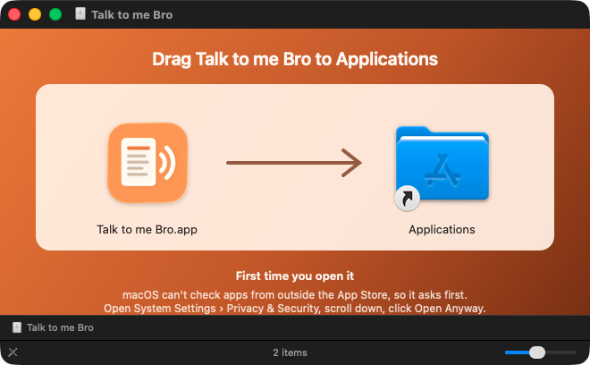
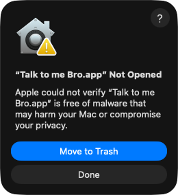
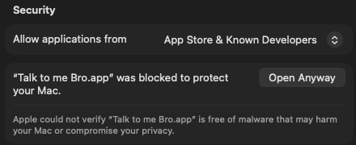

# Talk to me Bro

[](https://buymeacoffee.com/stephanepoulin)

[English](README.md) · **Français**

[](https://github.com/spoulin/talk-to-me-bro/releases/latest/download/TalkToMeBro.dmg)

Pour macOS 14 ou plus récent, sur les Mac Apple silicon et Intel. Voir [Installer](#installer).

Lecteur d'articles pour macOS : on lui envoie un article depuis son navigateur, il l'affiche sans pub ni
mise en page (façon « Just Read ») et le **lit à voix haute**, avec la voix de macOS ou une voix Piper locale.

## Installer

1. Cliquez sur **Télécharger** ci-dessus pour obtenir `TalkToMeBro.dmg`, puis ouvrez-le.
2. Glissez Talk to me Bro sur Applications.

   

3. Ouvrez Talk to me Bro depuis Applications. La première fois, macOS dit qu'il ne peut pas le
   vérifier, parce qu'il ne vient pas de l'App Store ni d'un développeur connu d'Apple. Cliquez sur
   **Terminé** (Done), pas sur Placer dans la corbeille.

   

4. Ouvrez **Réglages Système › Confidentialité et sécurité**, descendez jusqu'à **Sécurité**, et cliquez
   sur **Ouvrir quand même** à côté du message sur Talk to me Bro. Confirmez avec votre mot de passe ou
   Touch ID, puis cliquez encore sur **Ouvrir quand même**.

   

   Vous avez cliqué sur Placer dans la corbeille par erreur ? Ouvrez de nouveau `TalkToMeBro.dmg`,
   glissez Talk to me Bro sur Applications et reprenez à l'étape 3.

Il ne faut le faire qu'une fois : ensuite, Talk to me Bro s'ouvre comme n'importe quelle app. L'ouvrir
une fois ajoute aussi **Lire avec Talk to me Bro** aux menus Partager.

Pour mettre à jour, choisissez **Talk to me Bro › Rechercher des mises à jour…** : la page de la
dernière version s'ouvre. Téléchargez-la et glissez-la de nouveau sur Applications, en remplaçant
l'ancienne. L'historique, la liste de lecture et les réglages restent tels quels.

## Construire

```bash
git clone https://github.com/spoulin/talk-to-me-bro.git
cd talk-to-me-bro
scripts/build-app.sh
open "build/Talk to me Bro.app"
```

Prérequis : macOS 14+, Xcode / Swift 6.

Pour l'installer dans `/Applications` (la commande construit d'abord l'app ; si l'app installée est
ouverte, elle la quitte puis la rouvre) :

```bash
npm run install-app
```

Sans Node : `scripts/install-app.sh`.

### Versions publiées

Un tag de version publie une version : le workflow Release (`.github/workflows/release.yml`)
construit Talk to me Bro pour Apple silicon et Intel, fabrique `TalkToMeBro.dmg` et le joint à une
release GitHub, vers laquelle pointe toujours le lien Télécharger ci-dessus.

```bash
git tag v1.0.0
git push origin v1.0.0
```

Pour fabriquer l'image disque sur votre Mac : `pip3 install dmgbuild`, puis
`UNIVERSAL=1 scripts/build-app.sh` et
`NAME="Talk to me Bro" tools/make-dmg.sh "build/Talk to me Bro.app" TalkToMeBro.dmg`. Son fond est
dessiné par `tools/make-dmg-background.swift`, et sa disposition est dans `tools/dmg-settings.py`.
L'app est signée ad hoc, sans notarisation, d'où l'étape « Ouvrir quand même » au premier lancement.

## Utilisation

Pour ouvrir un article :
- dans le navigateur, **Partager › Lire avec Talk to me Bro** ;
- ou glisser un lien dans la fenêtre ;
- ou copier un lien, puis ⇧⌘V.

La lecture démarre toute seule. La barre du bas montre la progression (cliquer ou glisser pour sauter
à un paragraphe), le temps restant, les commandes et ce qui suit. La barre d'outils regroupe la playlist,
la vitesse et les pauses, le volume (🔊), la voix et la taille du texte.

Le volume est une part du volume du Mac, retenue à part pour la lecture et pour les vidéos : une fois réglé,
passer d'une vidéo YouTube à un article ne demande plus de toucher aux touches de volume. Avec une voix
Piper, un changement s'entend tout de suite ; avec une voix macOS, au paragraphe suivant.

| Action | Raccourci |
| --- | --- |
| Lire / Pause | espace (dans l'article) ou ⌥⌘P |
| Paragraphe précédent / suivant | ← / → (dans l'article) ou ⌥⌘← / ⌥⌘→ |
| Article suivant de la playlist | ⌥⌘↓ |
| Arrêter | ⌥⌘. |
| Écouter le lien copié | ⇧⌘V |
| Retour à l'accueil (la playlist est gardée) | Échap ou ✕ |
| Ouvrir la page d'origine dans le navigateur | ⇧⌘O |
| Taille du texte | ⌘+ / ⌘- / ⌘0 |

- Pendant la lecture, cliquer un paragraphe y saute ; ⌥-clic démarre la lecture à ce paragraphe.
- Les liens de l'article s'ouvrent dans le navigateur habituel.
- Les **touches multimédia** marchent même quand l'app est en arrière-plan : ⏯ lit ou met en pause,
  ⏭ passe à l'article suivant de la playlist. Elles marchent aussi depuis les écouteurs, le Centre de
  contrôle ou les boutons Multimédia d'un Stream Deck, et l'article ou la vidéo s'affiche dans À l'écoute.
- **Pauses** (menu de la vitesse) : Aucune, Courtes, Moyennes (par défaut) ou Longues, après chaque
  paragraphe et, plus courtes, après chaque phrase, pour un débit moins monotone.

## Playlist

- Partager (ou glisser, ou ⇧⌘V) un article pendant qu'un autre joue ou est en pause : il va dans la
  **playlist** au lieu de couper la lecture (« Ajouté à la playlist »).
- Quand un article est lu jusqu'au bout, le suivant démarre tout seul et sort de la liste. ⏭ (ou ⌥⌘↓)
  passe au suivant ; ✕ ou Échap revient à l'accueil et garde la playlist. Quand il n'y a plus rien à écouter, l'app revient à l'accueil.
- Le bouton playlist de la barre d'outils (avec le nombre d'articles en attente) ouvre la liste :
  glisser pour réordonner, Suppr ou clic droit pour retirer, *Vider* pour tout enlever, double-clic pour
  écouter un article tout de suite.
- La playlist est conservée quand on quitte l'app ; l'écran d'accueil propose de la reprendre.

## Sources

**Réglages › Sources** : coller l'adresse d'un site (ex. : `example.com/nouvelles`) ou d'un flux RSS/Atom.
Pour un site, l'app cherche le flux annoncé par la page, puis essaie les adresses de flux habituelles
(`…/rss`, `/feed`, `/rss.xml`…) et les flux listés sur une page « RSS » liée depuis l'accueil, sinon elle
charge la page (JavaScript compris) et garde ses liens
d'articles (mode « approximatif », sans dates).

L'accueil affiche alors **À lire** : les derniers articles de toutes les sources, du plus récent au plus
ancien (un article sans date dans sa source la prend dans l'article lui-même), en cartes façon magazine (le plus récent en grand) ou en liste (⊞ / ▤). Les images viennent du
flux, de la page, ou de l'image de partage de chaque article (`og:image`). Les articles déjà lus sont
grisés et marqués « Lu » (👁 pour les masquer ; le choix est retenu) ; un article présent dans plusieurs sources n'apparaît qu'une fois. Clic pour écouter, ➕ pour ajouter à la playlist, *Tout écouter* pour
mettre les non lus en file (▾ pour écouter plutôt du plus ancien au plus
récent ; le choix est retenu). Des onglets (en icônes, nommés au survol) montrent *Tout*, seulement les *Articles* ou les *Vidéos*, la
*Playlist* (avec son nombre d'articles) ou l'*Historique* ; les vidéos portent une marque 🎥. Les sources s'actualisent au lancement, puis toutes les 30 minutes par défaut
(de toutes les 5 minutes à au lancement seulement, dans *Réglages › Sources* ; ↻ pour actualiser tout de suite).
Le bouton ↻ affiche l'heure de la dernière actualisation.

Le bouton diaporama montre les articles de l'onglet un à un, image et titre, quelques secondes chacun (de 5 à
60, durée retenue), en boucle : les nouveaux articles s'y ajoutent à mesure que les sources s'actualisent. Clic
sur une diapo (ou Retour) pour l'écouter ; à la fin, ou avec Échap, le diaporama revient, sur l'article suivant.
← → pour avancer ou reculer, Espace pour la pause, Échap pour fermer ; les commandes apparaissent quand la
souris bouge. Dans *Réglages › Diaporama* : la durée par article, la transition (fondu enchaîné, fondu au noir,
glissement, zoom, flou, volet ou aléatoire), un zoom lent sur les images (effet Ken Burns) et le titre qui
apparaît juste après l'image.

## Pages vidéo

Certains « articles » ne sont qu'une vidéo (ex. : `ici.radio-canada.ca/info/videos/…`). Quand une page a
une adresse de vidéo, ou très peu de texte autour d'une grande vidéo, l'app passe en **mode vidéo** : la
page d'origine est affichée avec son lecteur isolé, centré à ses proportions dans la fenêtre, et le reste
masqué. La barre du lecteur et la barre d'outils habituelles le pilotent : position et temps restant, lecture/pause,
⟲ 15 s / ⟳ 15 s, vitesse, volume, article suivant (les commandes du site marchent aussi). La vidéo démarre toute seule ; les pubs du site, s'il y en a,
sont jouées sans le son (« Pub · son coupé » dans la barre) et le son revient pour la vidéo. À la fin de la vidéo, l'article
suivant de la playlist démarre. Les pages vidéo ont un badge « Vidéo » dans À lire.

**Musique pendant les pubs** (*Réglages › Vidéos*) : pendant qu'une pub passe sans le son, une radio joue à
la place (un lien `.pls` ou `.m3u` comme `https://somafm.com/illstreet.pls`, ou l'adresse d'un flux), ou un
fichier audio, ou un dossier de musique (« Pub · musique » dans la barre). Elle arrive et repart en fondu, et
le son de la vidéo revient en fondu lui aussi. Les réglages donnent le volume de la musique (aussi dans 🔊
pendant une vidéo) et la durée des fondus ; *Écouter* fait entendre la source quelques secondes. Une radio
reprend au direct ; des fichiers reprennent où ils s'étaient arrêtés. Vide : le silence.

Les liens **YouTube** (vidéos, Shorts, `youtu.be`) passent par le lecteur intégrable de YouTube en mode
confidentialité (`youtube-nocookie.com`, comme le Duck Player de DuckDuckGo) : pas de page YouTube autour,
pas de cookies de suivi, titre et chaîne venant de YouTube, et la même barre du lecteur. Une chaîne YouTube
ajoutée comme source utilise son flux RSS (ex. : `youtube.com/@chaine`).

## Historique

Le bouton historique (🕘) de la barre d'outils liste les 50 derniers articles lus ; un clic relit
l'article. Le clic droit permet de l'ajouter à la playlist, de l'ouvrir dans le navigateur ou de le
retirer. L'écran d'accueil montre les cinq derniers.

## Prononciation

**Réglages › Prononciation** : un dictionnaire de mots à lire autrement, par exemple `soccer` → `soqueur`.

- Sans tenir compte des majuscules, et seulement sur des mots entiers ; le surlignage reste sur le mot
  d'origine.
- `[pause]` (0,6 s) ou `[pause 1.5]` (secondes) dans « Écriture phonétique » ajoute un silence, par exemple
  `—` → `[pause 0.4]`.
- Pauses automatiques : « … » et « ... », et avant et après les parenthèses et les crochets. Les numéros
  de note comme `[12]` ne sont pas lus. Une entrée du dictionnaire pour les mêmes caractères a priorité.
- ▶︎ fait entendre le mot passé par le dictionnaire, avec la voix actuelle.

## Voix par type

**Réglages › Voix › Voix par type** : une voix différente pour les titres, les légendes de photos et les
citations (« Même voix que le texte » par défaut), en mélangeant librement voix macOS et Piper.
*Annoncer les légendes* dit « Légende : » (dans la langue de l'article) avant une légende, une seule fois
pour plusieurs légendes de suite.

Les changements du dictionnaire et des voix par type s'appliquent dès le paragraphe suivant, sans couper
celui en cours.

## Choix des voix

Deux moteurs, choisis dans le menu des voix de la barre d'outils ; tout reste sur le Mac :

| Moteur | Qualité | Coût / compte | Confidentialité |
| --- | --- | --- | --- |
| **macOS** (par défaut) | Standard à Premium selon les voix téléchargées | Gratuit, rien à installer | Local |
| **Piper** (optionnel) | Neuronale, meilleure que les voix de base | Gratuit, sans compte | Local |

Si Piper échoue, la lecture continue avec la voix macOS. Ajouter un service de voix en ligne
(Azure, OpenAI, ElevenLabs…) = un `ClipSynthesizer` de plus, sur le modèle de `PiperSynthesizer`
(un moteur Azure complet existe dans le premier commit de l'historique git).

## Voix Piper (optionnel, local)

[Piper](https://github.com/OHF-Voice/piper1-gpl) : voix neuronales qui tournent sur le Mac.

1. **Réglages** (⌘,) → *Installer Piper* (environ 200 Mo ; nécessite Python 3.9+, par exemple
   `brew install python` ou python.org).
2. *Voix à télécharger* → choisir une voix (30 à 80 Mo), par exemple Siwis ou Tom.
3. La voix apparaît dans le menu des voix de la barre d'outils.

- Tout est installé dans `~/Library/Application Support/local.browspeaker/piper` (environnement Python
  à part, voix, journal `piper.log`) ; *Désinstaller Piper* supprime ce dossier.
- Un petit serveur Piper local (127.0.0.1) garde la voix chargée pendant la lecture ; il s'arrête avec l'app.
- En français, Piper n'a que des voix de France (pas de voix québécoise).
- Le mot surligné est estimé (Piper ne donne pas le minutage des mots), le paragraphe est exact.
- **Effet sur la voix** (Réglages, onglet Voix) : Chaleur, Pièce, Studio, Salle, Cathédrale ou Écho,
  avec son intensité, pour donner du corps à la voix. Les changements s'entendent tout de suite.

## Partager vers Talk to me Bro

Depuis n'importe quelle app (Safari, Chrome, Mail, Notes…), menu **Partager › Lire avec Talk to me Bro** :
Talk to me Bro s'ouvre (ou passe au premier plan s'il tourne déjà), charge la page, passe en mode lecture
et commence à lire. Ça marche avec un lien, ou avec du texte qui contient un lien (c'est ce qu'envoie
Dia : l'adresse en texte, sans `https://`).

- Si l'option n'apparaît pas : *Réglages Système › Général › Ouverture et extensions › Partage*
  (ou *Partager › Modifier les extensions…*), puis cocher « Lire avec Talk to me Bro ».
- Après avoir déplacé l'app à la main, l'ouvrir une fois pour que macOS réenregistre l'extension
  (`npm run install-app` s'en charge).
- Sous le capot, l'extension ouvre `browspeaker://read?url=<adresse encodée>`. On peut utiliser ce lien
  ailleurs (Raccourcis, scripts, `open "browspeaker://read?url=…"`).

## Ouvrir avec Talk to me Bro

Clic droit › **Ouvrir avec › Talk to me Bro** dans le Finder, sur :

- un signet `.webloc` (lien glissé depuis un navigateur sur le bureau) ;
- un raccourci Windows `.url` ;
- un fichier `.html`.

Talk to me Bro se déclare aussi comme navigateur (`http`/`https`) : il peut être choisi dans
*Réglages Système › Bureau et Dock › Navigateur web par défaut* ou dans un sélecteur de navigateur,
et répond à `open -a "Talk to me Bro" https://…`. Dans tous les cas, la page s'ouvre dans la fenêtre
existante, passe en mode lecture et la lecture commence.

## Fonctionnement

- `BrowserModel` : un `WKWebView` caché charge la page, un second affiche l'article épuré.
- Extraction de l'article avec [Mozilla Readability](https://github.com/mozilla/readability)
  (`Resources/Readability.js`, v0.5.0, licence Apache 2.0), exécutée dans un monde JS isolé de la page.
- Readability retire souvent la photo principale, placée au-dessus du titre : la vue lecture affiche l'image de
  partage de la page (`og:image`) sous le titre, sauf si l'article s'ouvre déjà sur une photo ou montre celle-là.
- La vue lecture désactive le JavaScript de la page ; seul le script de Talk to me Bro y tourne.
- `SpeechController` : état de lecture, choix de la voix et du moteur (`SpeechEngine`).
- `SystemSpeechEngine` : `AVSpeechSynthesizer`, avec la voix système (`NSSpeechSynthesizer.defaultVoice`),
  relue à chaque lecture.
- `SpeechScript` : découpe les paragraphes en segments (phrases, pauses) et applique le dictionnaire de
  prononciation, en gardant le lien avec le texte de l'article pour le surlignage.
- `ClipSpeechEngine` : moteurs qui produisent un fichier audio par segment (Piper), avec
  préchargement des suivants.
- Les voix **Siri** ne sont pas accessibles aux applications tierces : dans ce cas, Talk to me Bro
  prend une voix de la même langue (indiqué « remplacement » dans le menu).

L'interface est en anglais par défaut et en français si le Mac est en français
(`Resources/fr.lproj`, `ShareExtension/fr.lproj`).

Le code et les identifiants internes gardent l'ancien nom (`BrowSpeaker`, `local.browspeaker`,
`browspeaker://`) : le nom affiché peut changer sans casser le partage ni « Ouvrir avec ».

## Licence

[MIT](LICENSE). Inclut [Mozilla Readability](https://github.com/mozilla/readability)
(`Resources/Readability.js`, Apache 2.0). Piper n'est pas inclus : l'app l'installe sur demande, sous sa
propre licence ([GPL-3.0](https://github.com/OHF-Voice/piper1-gpl)).

## Soutien

Si Talk to me Bro repose vos yeux (il vous lit les articles), vous pouvez m'offrir un café.

<a href="https://buymeacoffee.com/stephanepoulin"></a>

Fait par [Stéphane Poulin](https://www.stephanepoulin.com).
